# Penetration Testing Report

## Footprinting, OSINT and Network Scanning

**Prepared by:** Sanvir Kaur\
**Role:** Cybersecurity Intern\
**Practical activity dates:** 8--13 November 2026\
**Primary domain:** `networkwalks.com`\
**Local lab subnet:** `10.0.0.0/24`

> **Scope and authorization:** This repository documents educational,
> non-destructive reconnaissance and host-discovery activities. The
> internship authorization scope provided for this exercise covers
> `networkwalks.com` and the intern's own LAN, and permits
> footprinting/reconnaissance and network scanning/host discovery only.
> Exploitation, unauthorized access, privilege escalation,
> denial-of-service, brute-force/password attacks, data access or
> modification, and social engineering are outside the permitted scope.
> Networkwalks has permitted public sharing of the domain-related
> information documented here. The authorization letter itself is not
> included in this repository.

------------------------------------------------------------------------

## 1. Executive Summary

This practical assessment focused on authorized footprinting and
public-source OSINT for `networkwalks.com`, together with host discovery
on my own virtual lab network (`10.0.0.0/24`). I used WHOIS, WhatWeb,
`nslookup`, cURL, WAFW00F, DNSRecon, Maltego, theHarvester and
Zenmap/Nmap to collect and review information.

The activities identified publicly observable domain, DNS and web
technology information. WAFW00F detected ModSecurity, Maltego returned
one domain-to-email relationship, and theHarvester's Baidu source
returned no results in the recorded run. The all-source theHarvester
run was limited by unavailable or invalid provider API keys. Zenmap
discovered three live hosts on the local virtual subnet.

No exploitation, port scanning of Networkwalks' public infrastructure,
or vulnerability validation was performed. The observations in this
report should therefore be treated as reconnaissance results, not
confirmed vulnerabilities.

## 2. Introduction

As part of my cybersecurity internship practical work, I used Kali Linux
tools to gather publicly observable information about
`networkwalks.com`. I also used Zenmap to discover active devices on my
own virtual LAN.

This report documents the tools I used, their purpose, the results I
observed and screenshots of the practical work, including a
`theHarvester` OSINT exercise against `networkwalks.com`.

## 3. Scope of Assessment

**In-scope activities documented in this report**

- Passive/publicly observable footprinting and reconnaissance for
  `networkwalks.com`.
- DNS lookups and DNS record enumeration for the domain.
- Web technology and HTTP-header identification.
- Public-source OSINT using Maltego and theHarvester.
- Ping/host discovery on my own virtual lab subnet:
  `10.0.0.0/24`.

**Out of scope / not performed**

- Exploitation, gaining unauthorized access or privilege escalation.
- Denial-of-service, brute-force or password attacks.
- Accessing, copying, modifying or deleting data.
- Social engineering.
- Port scanning or service detection against Networkwalks' public
  infrastructure.
- Testing systems outside the authorized scope.

The local Zenmap scan in this report applies only to the intern's
virtual lab network and must not be interpreted as a scan of
Networkwalks' infrastructure.

## 4. Tools Used

| Tool | Purpose |
|---|---|
| Kali Linux | Environment used for reconnaissance and OSINT activities |
| whois | Collect domain registration details, registrar and name servers |
| whatweb | Identify technologies used by a website |
| `nslookup` | Resolve a domain name to an IP address |
| curl | Inspect HTTP response headers |
| wafw00f | Identify whether a Web Application Firewall is detected |
| dnsrecon | Enumerate DNS records such as NS, MX, TXT and SRV |
| Zenmap / Nmap | Discover active hosts on a local subnet |
| `ip link` | Display network interface and MAC address information |
| Maltego | Visualize relationships between domain and email entities |
| theHarvester | Collect publicly available OSINT from supported search sources |

## 5. Methodology

The work followed this sequence:

1. **Domain footprinting:** collected registration information and
   identified publicly visible website technologies.
2. **DNS enumeration:** resolved the domain and reviewed available DNS
   records.
3. **Web response review:** inspected HTTP response headers and checked
   for WAF detection.
4. **Public-source OSINT:** used Maltego and theHarvester to review
   publicly indexed domain-related information.
5. **Local network discovery:** used Zenmap/Nmap ping scan on the
   authorized virtual lab subnet.
6. **Documentation:** recorded commands, observations, evidence and
   limitations. Findings were not treated as vulnerabilities unless
   validated, and no exploitation was attempted.

## 6. Activities Performed

### 3.1 Website Footprinting and Reconnaissance

#### WHOIS

**Command**

``` bash
whois networkwalks.com
```

**Purpose:** Find domain registration information, registrar details and
name servers.

**Observed results** - Registrar: GoDaddy.com, LLC - Creation date: 6
November 2019 - Registry expiry date shown: 6 November 2027 - Name
servers: `NS6135.HOSTGATOR.COM` and `NS6136.HOSTGATOR.COM`

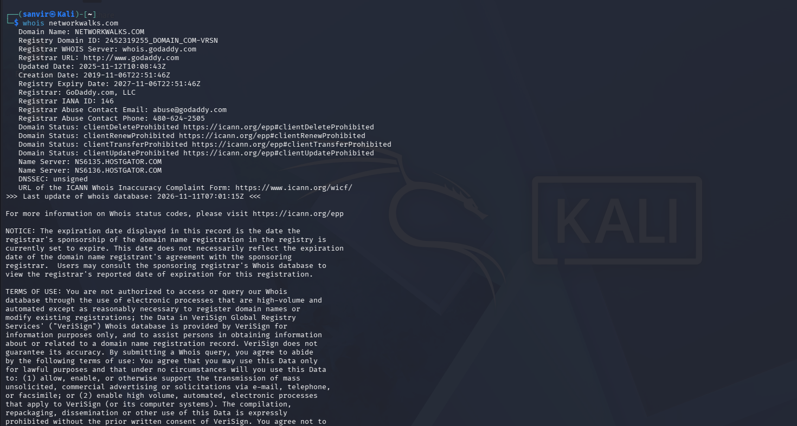

#### WhatWeb

**Command**

``` bash
whatweb networkwalks.com
```

**Purpose:** Identify technologies used by the website.

**Observed results** - Apache - WordPress 7.1.4 - WP Download Manager
3.3.76 - jQuery 3.7.1 - Bootstrap-related information and other website
metadata

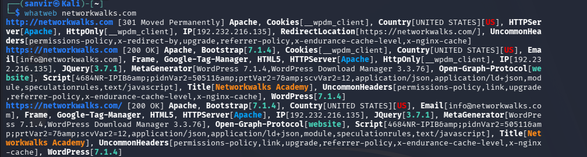

#### nslookup

**Command**

``` bash
nslookup networkwalks.com
```

**Purpose:** Resolve the domain name to its IP address.

**Observed result:** DNS server `8.8.8.8` returned `192.232.216.135` for
`networkwalks.com`.

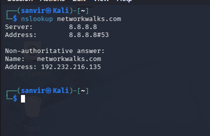

#### CURL

**Command**

``` bash
curl -I http://networkwalks.com
```

**Purpose:** Inspect the HTTP response headers.

**Observed results** - HTTP response: `301 Moved Permanently` - Redirect
destination: `https://networkwalks.com/` - Server header: Apache -
WordPress-related redirect information was present in the response.

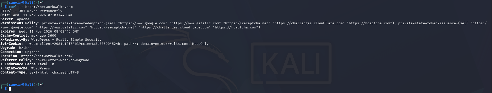

#### WAFW00F

**Command**

``` bash
wafw00f networkwalks.com
```

**Purpose:** Identify whether a Web Application Firewall is detected.

**Observed result:** WAFW00F identified **ModSecurity (SpiderLabs)**
protecting `https://networkwalks.com`. The tool completed the check
using two requests.

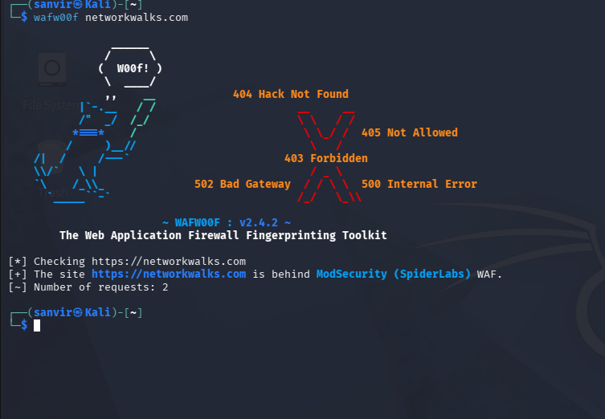

#### DNSRecon

**Command**

``` bash
dnsrecon -d networkwalks.com
```

**Purpose:** Enumerate DNS records.

**Observed results** - DNSRecon reported 8 records. - The output
included SOA, NS, A, MX, TXT and SRV records. - The A record resolved
`networkwalks.com` to `192.232.216.135`. - Mail and cPanel autodiscover
information was also displayed. - The DNSSEC query returned no answer.

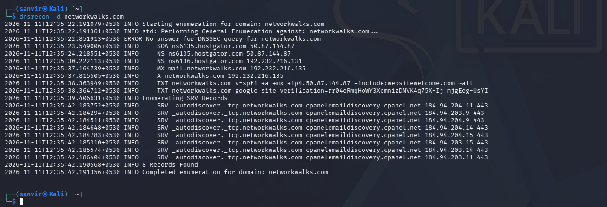

### 3.2 Network Scanning with Zenmap

I used Zenmap to scan my virtual LAN. The target subnet was
`10.0.0.0/24`, and I selected the **Ping Scan** profile.

**Command**

``` bash
nmap -sn 10.0.0.0/24
```

**Observed results**

| IP address | Observation |
|---|---|
| `10.0.0.1` | Host up; QEMU virtual NIC |
| `10.0.0.2` | Host up; my Kali Linux machine |
| `10.0.0.7` | Host up; Oracle VirtualBox virtual NIC |

-   Total addresses scanned: 256
-   Live hosts discovered: 3
-   Scan duration: 1.94 seconds

This was a host-discovery scan. It did not perform a port scan or
identify services.

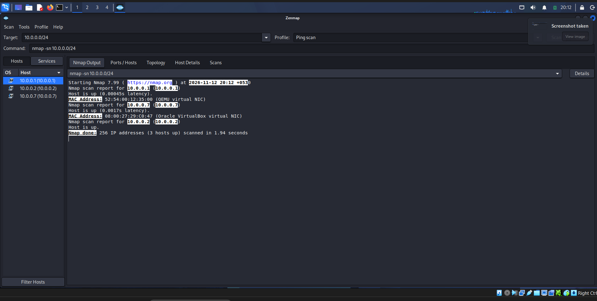

#### Network Topology

The Zenmap Topology tab displayed the three discovered hosts in a visual
layout.

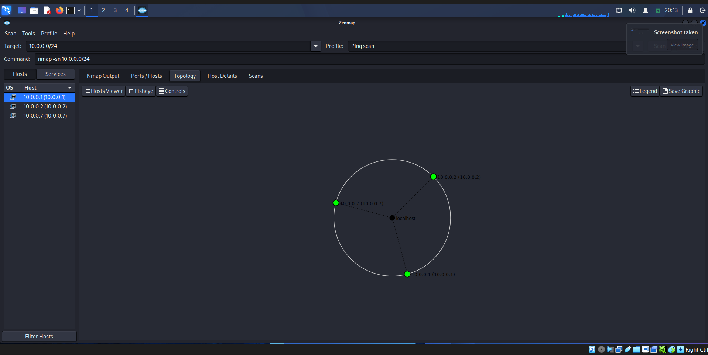

#### Kali Network Interface

**Command**

``` bash
ip link show eth0
```

**Observed result:** The `eth0` interface was UP. Its MAC address.

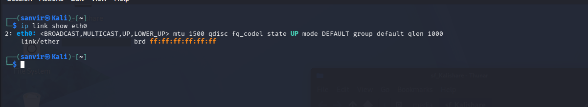

### 3.3 Additional OSINT Activities

#### Maltego

I used Maltego to create a graph for `networkwalks.com`. The graph
showed a relationship between the domain and `info@networkwalks.com`.
The transform returned one email entity.

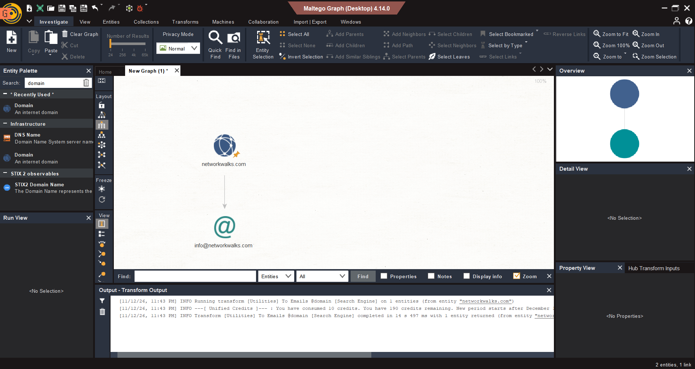

#### theHarvester

I ran theHarvester against `networkwalks.com` using two source
configurations.

**First command — Baidu**

```bash
theHarvester -d networkwalks.com -l 1000 -b baidu
```

The Baidu search returned no IP addresses, email addresses, people or
hosts in this run. This means the selected source did not return
discoverable results; it does not prove that no public information
about the domain exists.

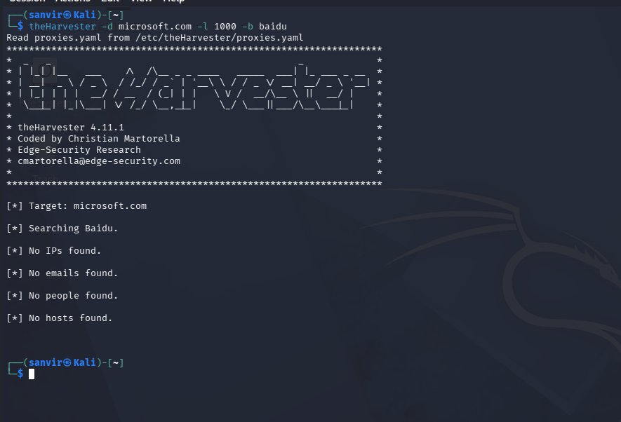

**Second command — all configured sources**

```bash
theHarvester -d networkwalks.com -l 50 -b all
```

The all-source run reported missing or invalid API-key configuration
for several providers, including BeVigil, Bitbucket, BufferOverrun,
BuiltWith, Brave Search, Censys, CriminalIP, DeHashed and DNSDumpster.
Because these sources could not be queried successfully, this run
cannot be treated as a complete OSINT result or as evidence that no
records exist.

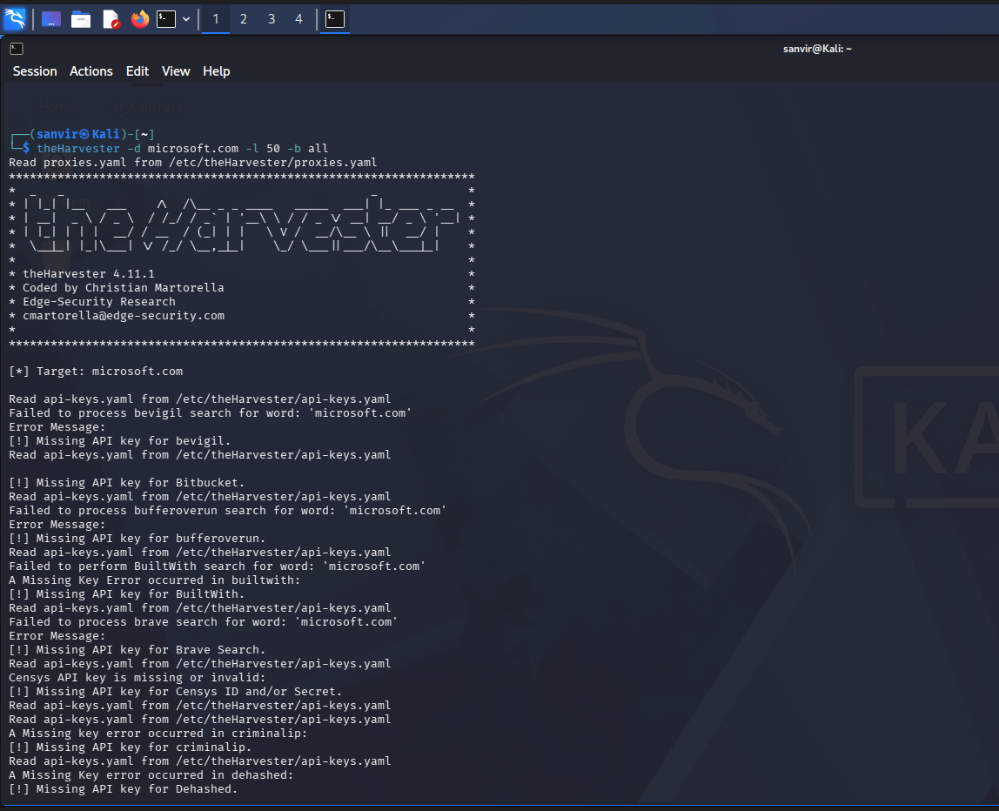

## 7. Risk Analysis / Impact

The following are potential risks based on the information collected.
These observations are not confirmed vulnerabilities.

| # | Observation | Potential impact | Risk |
|---:|---|---|---|
| 1 | Web technology and version information is visible. | May help attackers identify technologies for further research. | Medium |
| 2 | Public IP address identified through DNS. | Provides information about the website's hosting address. | Low |
| 3 | HTTP response headers reveal server details. | May assist technology fingerprinting. | Low |
| 4 | DNS records reveal hosting and mail infrastructure. | Can help build a broader infrastructure profile. | Medium |
| 5 | ModSecurity WAF identified by WAFW00F. | Reveals the WAF product in use; detection does not establish whether its rules are effective. | Low |
| 6 | Three live hosts discovered on the virtual LAN. | Unknown devices on a network should be identified and verified. | Low |

The presence of technology information, DNS records or live hosts does
not by itself mean that a system is vulnerable. No exploitation or
vulnerability validation was performed.

## 8. Recommendations

1.  Review publicly exposed technology information and limit unnecessary
    version disclosure.
2.  Keep WordPress, plugins and other web components updated.
3.  Review HTTP response headers and ensure HTTPS is consistently
    enforced.
4.  Review DNS records regularly and remove records that are no longer
    required.
5.  Keep ModSecurity enabled, updated and properly configured. Review
    its logs and rules regularly.
6.  Perform regular internal network discovery and investigate unknown
    devices.
7.  Keep network topology and device documentation updated.
8.  Configure required API keys securely when using OSINT tools; never
    publish secrets in a GitHub repository.
9.  Perform further security testing only with appropriate written
    authorization.

## 9. Testing Limitations

- TheHarvester's Baidu source returned no results during the recorded
  run. This does not establish that no public information exists.
- Several theHarvester providers could not be queried because their
  API keys were missing or invalid. The all-source run was therefore
  incomplete.
- The Zenmap scan was a ping/host-discovery scan of
  `10.0.0.0/24`; it did not perform port scanning or service detection.
- The Zenmap results describe the intern's virtual lab, not
  Networkwalks' public infrastructure.
- No exploitation, authenticated testing or vulnerability validation
  was performed.
- Results represent observations at the time of testing and may change.

## 10. Evidence Register

| Evidence ID | Activity | Evidence file |
|---|---|---|
| E01 | WHOIS domain lookup | `screenshots/whois.png` |
| E02 | WhatWeb technology identification | `screenshots/whatweb.png` |
| E03 | DNS resolution with nslookup | `screenshots/nslookup.png` |
| E04 | HTTP headers with cURL | `screenshots/curl-headers.png` |
| E05 | WAF detection with WAFW00F | `screenshots/wafw00f.png` |
| E06 | DNS enumeration with DNSRecon | `screenshots/dnsrecon.png` |
| E07 | Zenmap local host-discovery scan | `screenshots/zenmap-scan.png` |
| E08 | Zenmap topology | `screenshots/zenmap-topology.png` |
| E09 | Kali network interface details | `screenshots/kali-interface.png` |
| E10 | Maltego domain/email relationship | `screenshots/maltego.png` |
| E11 | theHarvester Baidu run for Networkwalks | `screenshots/theharvester-baidu.png` |
| E12 | theHarvester provider/API-key messages | `screenshots/theharvester-api-errors.png` |

## 11. Conclusion

During this practical exercise, I used multiple Kali Linux tools to
perform domain footprinting and OSINT, and Zenmap to discover devices on
my virtual LAN. WHOIS provided domain registration information, WhatWeb
identified web technologies, `nslookup` resolved the domain, cURL
inspected HTTP headers, WAFW00F detected ModSecurity, and DNSRecon
collected DNS records.

I also used Maltego to visualize a domain-to-email relationship and
theHarvester to understand OSINT collection and source/API limitations.
Zenmap identified three live hosts on the `10.0.0.0/24` virtual network
and displayed their topology.

These activities helped me understand the importance of reconnaissance,
network discovery and accurate technical documentation. All findings
should be interpreted within the limits of the tests performed and the
authorized scope.

------------------------------------------------------------------------

**Author:** Sanvir Kaur\
**Role:** Cybersecurity Intern\
**Activity:** Footprinting, OSINT and Network Scanning
